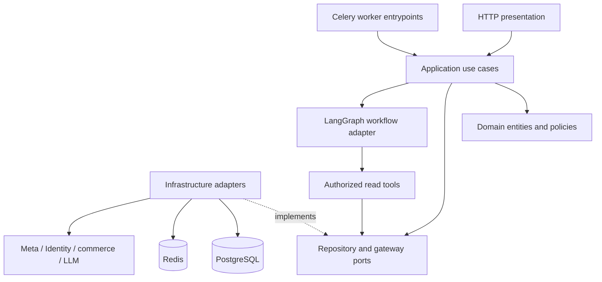

# Architecture and requirements

Status: P00 architecture baseline accepted after testing and validation; evidence and scope limits are recorded in [P00 validation](p00-validation.md).

## Document responsibility

This document owns scope, actors, bounded-context boundaries, dependency rules, use cases, and lifecycle contracts. It does not implement application behavior or set numeric policy. It depends on [PROJECT_CONTEXT.md](../../PROJECT_CONTEXT.md), [BUSINESS_CONSTANTS.md](../../BUSINESS_CONSTANTS.md), the [glossary](domain-glossary.md), and the ADRs linked below. P01–P24 implement this baseline. P00 documentation tests and the supplied P00 testing/validation prompts assess it; later phase tests verify runtime behavior.

## Product scope and priorities

The Marketing & Advertising bounded context extends the existing Maroc Affiliate platform. Sellers select an existing product and Content Hub creative, obtain a structured campaign proposal, approve its exact contents, and publish through a controlled Meta integration. Campaign analysis combines advertising spend with fulfilled commerce outcomes.

| Priority | Requirement | Delivery phase |
|---|---|---|
| MUST | Consume trusted platform identity, enforce permissions and seller ownership on every operation | P04 onward |
| MUST | Read Catalog, Inventory, Orders, and Content Hub through explicit adapters | P06 |
| MUST | Connect Meta securely and associate an authorized ad account with a seller | P07–P08 |
| MUST | Persist editable proposals independently of AI; AI produces schema-validated suggestions | P09–P10 |
| MUST | Apply deterministic policy validation and exact-payload human approval before any external mutation | P11–P12 |
| MUST | Enforce idempotency, durable execution records, audit, immediate revalidation, and explicit unknown outcomes | P12–P13 |
| MUST | Expose tenant-scoped campaign views and approved actions | P14 |
| MUST | Synchronize performance and calculate commerce-based profitability with visible source freshness | P15–P16 |
| MUST | Produce evidence-backed diagnosis/recommendations and constrained assistant interactions | P17–P18 |
| MUST | Provide audit, admin kill switch, dashboard notifications, security, monitoring, deployment, recovery, and handoff | P19–P24 |
| SHOULD | Explain rejected policies in seller-friendly language and preserve editable drafts | P09 onward |
| SHOULD | Present structured campaign views as well as conversational assistance | P14, P18 |
| SHOULD | Make data gaps and reconciliation progress visible without exposing unsafe provider details | P13 onward |
| NICE | Add server-side fulfilled-order conversion events | Optional P25 |
| NICE | Add recommendation-first automation rules | Optional P26 |
| OUT-OF-SCOPE | Autonomous spending, automatic unapproved pauses/budget changes, and LLM-issued Meta writes | All MVP phases |
| OUT-OF-SCOPE | A new identity provider, product/order/inventory management, and creative authoring/replacement of Content Hub | All MVP phases |
| OUT-OF-SCOPE | FX conversion, multiple ad channels, RAG/vector storage, agent swarms, Kafka, Kubernetes, microservices, and Temporal | All MVP phases; later changes require a new ADR |

P00–P12 is the minimum demonstrable loop. P13–P24 completes the production path, including additional product capabilities and hardening. A demonstration milestone does not waive mutation safety: P12 must record ambiguous results and block unsafe retries even before P13 adds scheduled reconciliation. Minimum audit events ship with each mutation; P19 adds the consolidated audit/admin experience. Production release requires the production gates, rather than treating a P12 demonstration as full operational readiness.

## Actors and use cases

| Actor | Authorized use cases | Boundary |
|---|---|---|
| Seller principal | Connect/disconnect Meta, select account/product/creative, generate/edit/approve proposals, view/manage own campaigns, view analysis and assistant threads | Platform membership, permissions, ownership, and current account access required |
| Platform administrator | Investigate operational state, control kill switch, manage explicitly authorized support operations | Explicit administrative permissions; audit all privileged actions; no implicit seller impersonation or token visibility |
| Service/worker principal | Execute persisted approved operations, synchronize metrics, reconcile uncertain outcomes, generate recommendations | Narrow service permission plus explicit persisted seller context; cannot create seller approval |
| Product owner | Resolve policy constants and launch dependencies | Product decisions do not grant application or Meta privileges |
| Operator/engineer | Deploy, monitor, restore, and support the service | Least-privilege operational access; cannot bypass approval through a job or console |

Core use cases are connection lifecycle, proposal creation/editing, validation, approval/rejection, publication, approved pause/resume/budget adjustment, synchronization, reconciliation, analytics, recommendations, and assistant thread/stream management. Reading is automatic only after authorization and tenant scoping. Disconnect invalidates credential use and pending readiness; it must not silently imply that existing Meta campaigns have stopped spending.

## Context ownership and integration boundaries

| Context/provider | Authoritative owner | Marketing & Advertising boundary |
|---|---|---|
| Identity | Principal identity, seller memberships, permission claims | Validate trusted identity; derive active seller context server-side; apply RBAC, ownership, and selected ABAC constraints |
| Catalog | Product identity, descriptive attributes, product status and commerce pricing/cost facts | Read typed seller-visible product snapshots; retain source/version references |
| Inventory | Sellable stock, reservations, warehouse eligibility and availability | Read authoritative current availability; never manufacture stock from a cached AI context |
| Orders | Order lifecycle, delivered/returned values, cost facts and attribution evidence | Read minimized, deduplicated commerce facts; no customer PII in LLM context |
| Content Hub | Creative identity, asset metadata, usage rights and seller access | Select existing authorized creative/version; verify ownership and availability before publication |
| Meta | Remote ad account permissions, remote object state and reported advertising metrics | Access only through MetaAdsGateway; map provider IDs/statuses/errors into typed application contracts |
| LLM provider | Untrusted generated structured suggestions | Access through provider abstraction; never owns policy, approval, or execution |

This context owns proposals, validation results, approvals, execution/reconciliation records, local campaign projections, performance/commerce snapshots, recommendations, assistant threads, and audit events. PostgreSQL is authoritative for these local records. It does not supersede Inventory or Orders as the source of commerce truth, or Meta as the source of remote state. Each imported fact records its origin, observed time, and available source version.

## Layering and deployment

Runtime control flow is `HTTP/Worker -> Application Use Case -> Domain Policies -> Repository/Gateway -> External/DB`. Runtime calls through injected interfaces do not reverse source-code dependency rules.

| Layer/location | Owns | Permitted dependencies |
|---|---|---|
| `api/` | Typed input/output, authentication dependencies, thin handlers, error translation | Application interfaces and shared transport/configuration types; no direct SQL or Meta calls |
| `application/` | Use cases, transaction boundaries, authorization orchestration, commands/results, external-service ports | Domain and its own ports; no FastAPI, Celery, SQLAlchemy, Meta SDK, or concrete LangGraph imports |
| `domain/` | Entities, value objects, state transitions, invariant policies, repository contracts | Standard library and framework-independent domain types only |
| `ai/` | LangGraph implementation of application workflow ports, prompts, output schemas, allowlisted read tools, evaluations | Application/domain contracts and LangGraph; no mutation credentials or direct financial mutation tools |
| `infrastructure/` | SQLAlchemy/Alembic, repositories, external APIs, Meta MCP/API, LLM transport, Redis, crypto | Domain/application ports and external libraries; translates provider types at boundary |
| `workers/` | Job entrypoints, scheduling, persisted-operation dispatch | Application interfaces and Celery; no alternate business-policy implementation |
| `core/`, `main.py` | Typed config, logging/error/telemetry primitives, composition root | Composition root wires concrete adapters; domain receives validated policy values, never imports runtime settings |

One modular monolith supplies HTTP and worker processes from the same release. PostgreSQL stores durable business and workflow state; Redis supports queues, cache, and ephemeral coordination. Redis locks alone cannot enforce budgets, idempotency, or approvals. Docker is the deployment baseline; managed PostgreSQL/Redis are initial services. No production files are created by P00.

## Narrow interface contracts

These are design contracts for subsequent phases, not executable signatures or finalized provider endpoints. Requests and responses use versioned typed schemas with explicit missing/unknown outcomes.

| Port | Input/output contract | Owner and implementation |
|---|---|---|
| Identity verifier | Trusted identity input -> Principal with verified membership/permissions, or authentication error | Application port; Infrastructure identity adapter |
| Catalog/Inventory/Orders/ContentHub readers | SellerContext + source identifier/query -> minimized typed snapshot with provenance, or scoped not-found/unavailable | Application ports; read-only Infrastructure adapters |
| Proposal/Approval/Execution repositories | SellerContext + local ID/version -> aggregate; compare-and-set writes require expected version | Domain repository contracts; PostgreSQL Infrastructure adapters |
| UnitOfWork | Transactional repository access, commit/rollback, durable dispatch intent and audit append | Application port; SQLAlchemy adapter |
| MetaAdsGateway | Seller/account reference + typed read query, or approved canonical mutation with operation ID -> known success, known rejection, or unknown outcome | Application port; Infrastructure MCP/API adapter |
| Credential store | Tenant-bound credential reference -> secret usable only inside trusted integration code | Infrastructure-only contract; crypto/key management adapter |
| Proposal/Analysis workflow | Authorized immutable context + bounded seller instructions -> structured proposal/analysis or typed failure | Application port; `ai/` LangGraph adapter |
| LLM provider | Sanitized messages + output schema + bounded request -> validated output/usage or typed error | Application-facing abstraction; Infrastructure provider adapter |
| Audit sink and dispatch | Durable event/intent within local transaction -> recorded ID; worker dispatch by that ID | Application ports; PostgreSQL-backed implementations |

External resource identifiers alone confer no access. Every repository and reader query requires trusted seller context. Every approval/execution lookup includes seller ID. Background jobs derive their seller scope from durable records and verify consistency with task input. Meta credentials are resolved internally; they never cross an application response or LLM tool boundary.

## Campaign proposal, approval, and execution lifecycle

Proposal state, approval status, execution status, and observed remote campaign status are separate concepts. A local request to publish is not proof of an active campaign.

| Proposal state | Allowed transition | Conditions |
|---|---|---|
| `DRAFT` | `VALIDATING`, `CANCELLED` | Mutable seller-owned draft; generation produces a draft, never an approval |
| `VALIDATING` | `AWAITING_APPROVAL`, `VALIDATION_FAILED` | Deterministic checks bind result to exact proposal revision and canonical payload |
| `VALIDATION_FAILED` | `DRAFT`, `VALIDATING`, `CANCELLED` | Edit increments revision; validation may rerun on the same revision when source facts change |
| `AWAITING_APPROVAL` | `APPROVED`, `REJECTED`, `DRAFT`, `CANCELLED` | Explicit authorized human decision; edits invalidate validation/approval readiness |
| `APPROVED` | `EXECUTION_PENDING`, `EXPIRED`, `DRAFT`, `CANCELLED` | Approval usable only for its exact payload and validity period; edit/cancel permitted only before execution claim |
| `EXPIRED`, `REJECTED` | `DRAFT`, `CANCELLED` | Revalidation and a new approval required |
| `EXECUTION_PENDING` | `PUBLISHED`, `EXECUTION_FAILED`, `CANCELLED` | Execution owns outcome; confirmed pre-dispatch execution cancellation moves the proposal to CANCELLED in the same transaction. Unknown results remain pending with visible reconciliation status |
| `EXECUTION_FAILED` | `DRAFT`, `CANCELLED` | New attempt requires revalidation and new approval; no automatic new publication intent |
| `PUBLISHED`, `CANCELLED` | Terminal for that proposal revision | Later campaign actions use new action payloads and approvals |

Approval statuses are `GRANTED`, `REJECTED`, `EXPIRED`, `INVALIDATED`, and `CONSUMED`. Approval records are durable evidence of approver, seller/account, action, proposal revision, canonical payload/digest and schema version, policy version, grant/expiry times, and consumption operation. Consumption reserves the approval for exactly one execution; retries of that same execution are not new approval uses. Approval validity is rechecked before any not-yet-sent mutation; reconciliation of an already-sent operation remains possible after expiry without authorizing a different write.

| Execution state | Transition and meaning |
|---|---|
| `PENDING` | Durable approved intent; transition to `EXECUTING` only after current permission, stock, account, kill-switch, approval and budget checks |
| `EXECUTING` | External dispatch may have occurred; transition to `SUCCEEDED`, `FAILED`, or `RECONCILIATION_REQUIRED` |
| `RECONCILIATION_REQUIRED` | Unknown/partial/stale execution; perform scoped remote reads. Move to `SUCCEEDED` when completion is proven, `FAILED` when terminal failure is proven, or back to `PENDING` only when non-application is proven and original approval remains valid |
| `SUCCEEDED` | Known intended remote result with stored remote IDs; terminal |
| `FAILED` | Known failure with no unresolved remote effects; terminal for this execution |
| `CANCELLED` | Allowed from `PENDING` only if dispatch has demonstrably not begun; cancellation after dispatch requests reconciliation, not fictional rollback |

Transient errors known to precede provider acceptance may return `EXECUTING` to `PENDING` under the configured retry policy and the same operation identity. Unknown outcomes never take that retry route. Exhausted or expired safe retries end in known failure only when there are no unresolved external effects.

Campaign projections separately expose desired state, observed Meta state mapped to `PENDING`, `ACTIVE`, `PAUSED`, `ARCHIVED`, `REJECTED`, or `UNKNOWN`, source observation time, and synchronization health. Unknown provider states stay `UNKNOWN`; they must not be interpreted as success, inactivity, or free budget capacity.

## Approval and mutation protocol

1. Verify identity, seller scope, action permissions, and account/creative/product ownership. Build an authorized, minimized source context with provenance.
2. For AI work, execute `Authorized Context -> LangGraph -> LLM Structured Output -> Deterministic Validation -> Human Approval -> Application Mutation`. The graph may interrupt/resume around approval, but a graph checkpoint is not an approval record.
3. Canonicalize the complete effective mutation payload, including account, targeting, creative/version, budget, schedule, currency, and action. Store the payload and validation evidence. Any effective change requires revalidation and a fresh approval.
4. Show that payload to the authorized human and persist the approval. A conversational statement, model output, or worker message cannot stand in for that record.
5. Before dispatch, re-fetch authoritative source facts and current permissions; require successful policy revalidation. Validate account currency against `PLATFORM_CURRENCY`. Recheck approval expiry and payload identity, kill switch, active-plus-reserved seller budget and cooldown. Stale or unavailable safety facts fail closed; no numeric freshness tolerance is invented.
6. In a PostgreSQL transaction, serialize the seller's budget claims, compare aggregate versions, consume the matching approval, create one execution/idempotency record, reserve budget, and append audit plus durable dispatch intent. A uniqueness constraint protects seller/action/key identity. Same key and same payload returns the existing operation; same key and different payload is a conflict.
7. Dispatch through the gateway, outside a long database transaction. Recheck eligibility after queue delays and immediately before mutation. Each step in a multi-object publication must fit the approved intent; persist known remote IDs and step outcomes. A database transaction cannot make an external API atomic.
8. Persist the known result and audit. On timeout, crash after send, partial remote creation, or a failed local result commit, retain reservation and require reconciliation. Never assume a database rollback undid a Meta write. Compensating remote writes require an explicitly approved action; they are not implicit cleanup.

Publish remote resources in a non-spending state where the verified gateway supports it, then perform only the activation covered by the approved payload. Provider behavior must be verified in P08/P12; no provider-side exactly-once guarantee is assumed. Historical execution records outlive the configured idempotency lookup TTL and are never deleted while unresolved.

An admin kill switch blocks subsequent dispatch and records the intervention; it cannot undo already dispatched mutations. Stopping existing spend requires explicit authorization and an approved action. Budget reservations account for unresolved operations conservatively and are released only on proven non-application or reconciled remote state.

## Decisions and evolution triggers

| Decision | Rationale and replacement trigger |
|---|---|
| [ADR-001: modular monolith](../adr/ADR-001-modular-monolith.md) | Shared transactional safety and small operating surface; extract a bounded context only with measured independent scaling, release, or ownership needs |
| [ADR-002: PostgreSQL](../adr/ADR-002-postgresql.md) | Durable authority and transactional invariants; add specialized analytical storage only after measured query isolation/optimization cannot meet agreed targets |
| [ADR-003: LangGraph](../adr/ADR-003-langgraph-state-machine.md) | Explicit bounded AI workflow and controlled interruption; change if required workflow behavior cannot be safely represented/maintained |
| [ADR-004: Celery](../adr/ADR-004-celery-before-temporal.md) | Scheduled/retryable jobs backed by durable local execution; introduce Temporal only when demonstrated workflow recovery complexity justifies it |
| [ADR-005: gateway](../adr/ADR-005-meta-gateway-abstraction.md) | Hide transport/provider details; replace adapter when verified capabilities or reliability require it |
| [ADR-006: approval](../adr/ADR-006-human-approval.md) | Human authority over exact financial intent; no MVP trigger removes approval |
| [ADR-007: no vector DB](../adr/ADR-007-no-vector-db-mvp.md) | Structured commerce context meets the MVP need; add retrieval only for an evaluated unstructured-data use case |

## Assumptions, unresolved contracts, and launch risks

| Item | Owner / resolution gate | Consequence and treatment |
|---|---|---|
| Finalized MVP business assumptions | Product owner approved initial values during P00; revisit before production | Values are centralized in BUSINESS_CONSTANTS; delivery cost remains a configurable assumption until measured. Typed startup validation in P02 fails on future missing/invalid values |
| Identity token/session contract, issuer/audience, membership revocation and support permissions | Platform Identity owner with engineering, before P04 | Define verifier contract and fixtures; no custom authentication system or trusted client seller ID |
| Commerce API schemas, inventory availability semantics, creative access, order/return and COGS facts | Platform owners with engineering, before P06; profitability semantics before P16 | Contract tests and typed adapters; missing authoritative data is unavailable, not zero |
| Meta Business verification | Product owner, start during P00 alongside P01 | Explicit launch dependency for P07; planning lead time is recorded in BUSINESS_CONSTANTS, not guaranteed here |
| Meta App Review for `ads_management` and `ads_read` | Product owner, start during P00; required before real-account P08/P12 | Prepare required review material and verification; approval status is unknown and has not been initiated by this documentation task |
| Creative/copy policy eligibility | Product owner, P10 acceptance and ongoing | Generated copy needs category-aware controls and human review; approval does not guarantee provider acceptance |
| Provider mutation, reconciliation, rate-limit and currency contracts | Engineering, P08/P12 | Verify actual provider behavior before implementing writes; gate unsupported recovery paths |
| Managed PostgreSQL/Redis, encryption key storage, secret provisioning | Engineering/operations, P03/P07/P15 | Deployment and recovery must preserve secret separation and durable records |
| Privacy retention and log identifiers | Product owner/security, before production logging/export | Default to data minimization; permit identifiers only under approved privacy policy |
| Commerce attribution and fulfilment lag | Product/commerce owners, P06/P16 | Use provenance and the configured attribution window; mark partial/unattributed data explicitly |

The launch lead times above are supplied planning assumptions, not independently verified current Meta guarantees. Nothing in P00 sends a review application or contacts an external party.

## P01 handoff

Use the roadmap's `src/marketing_ai/`, `tests/`, `docs/`, migrations, workers, and Infrastructure layout. P01 creates the Python packaging and quality toolchain; P02 adds runtime configuration and health behavior; later phases introduce their own dependencies. Do not install all future integrations in the foundation phase. Exact compatible package versions and development commands are selected and locked by P01 against supported releases.

The initially inspected workspace contained no README, pyproject, application, migrations, tests, or existing project conventions. P00 implementation created documentation and root context files; its testing step adds document-contract tests without application code or a P01 toolchain. It does not create a README solely to add links. The [P00 gates](p00-validation.md) now pass for this documentation scope, permitting P01 to begin. Boundary checks, fixtures, API contracts, and operational scenarios for later phases are specified in [non-functional requirements](non-functional-requirements.md); profitability semantics live in [profitability](profitability.md).
