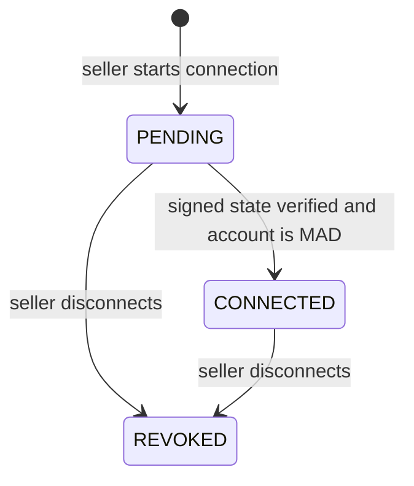

# P07: Meta connection lifecycle and credential references

P07 lets an authorized seller start, view, and disconnect their own Meta connection record. It creates only local connection metadata and an opaque reference to protected credentials. It does not make Meta advertising writes, publish campaigns, or imply that disconnecting a connection stops existing Meta campaigns.

## Lifecycle

`POST /meta/connections/start` requires `ADS_MANAGE`, creates a seller-scoped `PENDING` row, and returns a signed, short-lived OAuth state. The state binds the seller, initiating session, connection ID, and expiry. The callback use case verifies its HMAC, locks the pending row, rejects an expired, forged, seller-mismatched, or already-used state, then records the credential reference and linked MAD ad account. A replay sees `CONNECTED` and fails with `STATE_CONFLICT`.

`GET /meta/connections` requires `ADS_READ`. Each query includes the verified `seller_id`; a connection ID belonging to another seller is treated as absent. `DELETE /meta/connections/{connection_id}` requires `ADS_MANAGE`. It commits local `REVOKED` state and deactivates the account link before attempting best-effort protected-vault revocation, so a vault outage cannot restore application access.

## Credential handling and deployment composition

The ordinary PostgreSQL tables contain account metadata, status, OAuth-state digests, and `credential_reference`. They never contain an OAuth token. `EnvelopeTokenVault` accepts a deployment-provided envelope encryptor and secret manager: ciphertext goes to the secret manager and the database receives only its opaque reference. The test-only in-memory vault is never composed by `create_app`.

To enable start/disconnect at deployment, provide all of the following through protected configuration/composition:

- the Meta OAuth state signing secret and TTL together. There is no fallback TTL or signing secret.
- An application-state `meta_token_vault` that implements `store(plaintext) -> reference` and `revoke(reference)`. Production composition must use `EnvelopeTokenVault` with the organization’s KMS/envelope encryption and secret manager adapters.

If either runtime dependency is absent, lifecycle mutation endpoints return the existing controlled dependency-unavailable error. They do not accept a token from the frontend or return a token in a response. Do not log states, OAuth tokens, vault references, encryption keys, or Authorization headers.

## Persistence and concurrency

Migration `0002_create_meta_connections` creates `meta_connections` and `meta_ad_account_links`, indexes seller lookups, and enforces one linked external ad account per seller. Completion and disconnect use PostgreSQL `FOR UPDATE` locks on the seller-scoped connection. A failed repository write after vault storage triggers best-effort deletion of the newly stored reference.

## What P07 proves

The P07 unit tests cover signed-state verification/expiry/forgery, currency rejection before token storage, replay rejection, vault cleanup after a persistence failure, and local revocation despite vault failure. API tests cover unauthenticated and underprivileged requests, malformed start requests, seller scope propagation, and response redaction. Disposable PostgreSQL tests apply the real migration and prove tenant isolation, concurrent callback replay has one winner, and revocation remains durable when the vault fails.
